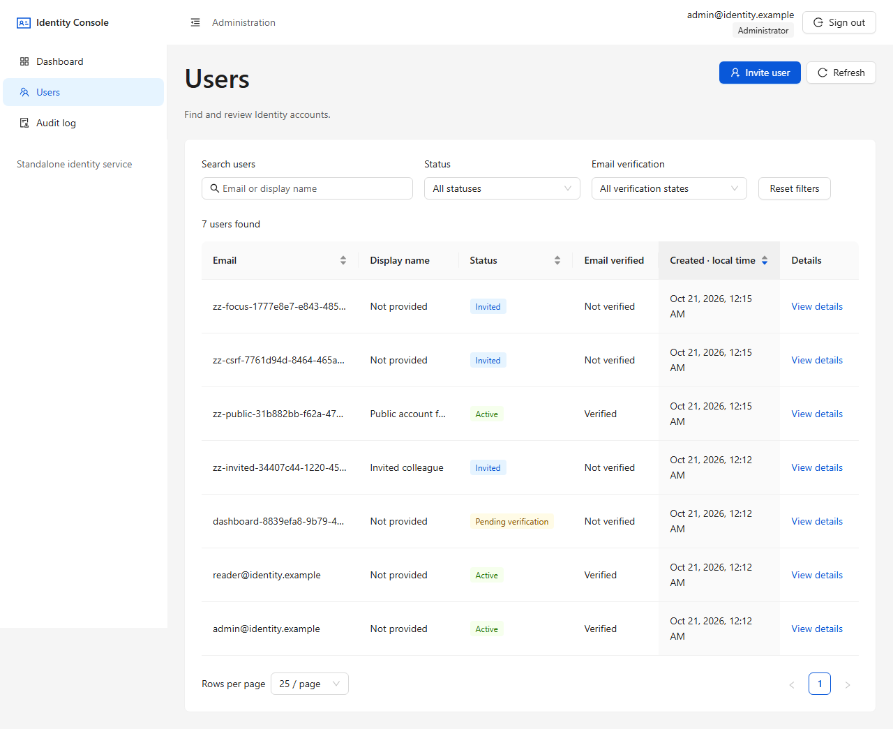
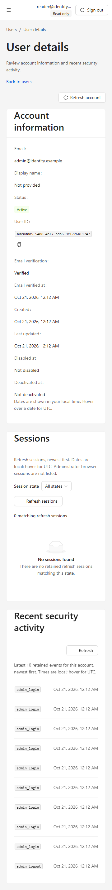
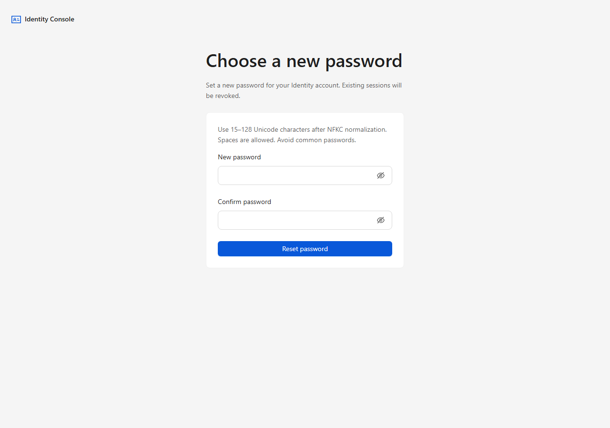

# Frontend acceptance — stage 11.14

Identity Console completes stages 11.1–11.14 on the existing Identity API.
No API contracts, migrations, authorization policies, deployment/proxy settings
or production dependencies changed. Release infrastructure remains stage 12.

## Checks and scenario matrix

From `src/Identity.Admin.Web`: `npm ci`, `npm run typecheck`, `npm run lint`,
`npm run format:check`, `npm run test:run`, `npm run build`.
From the repository root:

```powershell
pwsh -NoProfile -File scripts/Test-AdminWebSmoke.ps1
# Focused review; does not replace the complete suite:
pwsh -NoProfile -File scripts/Test-AdminWebSmoke.ps1 -AcceptanceOnly
```

The harness creates fresh PostgreSQL 17/Mailpit, keys, HTTPS certificates and accounts
per run; checks OpenAPI; builds the frontend; runs Playwright; checks `dist` for
fixture secrets. It cleans its own processes, volumes and temporary secrets in
`finally`. AcceptanceOnly runs one project with `--no-deps`; default runs everything.
Browser tests use the dev HTTPS proxy; production `dist` is built and inspected
separately. No external accounts or production deployment are involved.

| Scenario                                         | Browser coverage                                                               |
| ------------------------------------------------ | ------------------------------------------------------------------------------ |
| Admin/ReadOnly login, refresh, logout            | `auth.spec.ts`; real HttpOnly/Secure/SameSite cookie checks                    |
| Anonymous admin routes, expired/revoked sessions | `auth.spec.ts`, `acceptance.spec.ts`; hide view, clear cache, no redirect loop |
| Dashboard counts/registrations                   | `dashboard.spec.ts`; compare real backend values                               |
| Users search, filters, pagination, history       | `users.spec.ts`; server requests and URL restoration                           |
| Details, missing accounts, safe fields/dates     | `userDetails.spec.ts`; responsive layout/activity retry                        |
| Invite/resend and duplicate 409                  | `invitations.spec.ts`; real Mailpit, confirmation and role checks              |
| Disable/enable and last-admin 409                | `accountStatus.spec.ts`; sign-in/session rejection                             |
| Reset request                                    | `passwordReset.spec.ts`; real 202/audit/Mailpit, no password assignment        |
| Single/all session revocation                    | `sessions.spec.ts`; real rejected refresh and cookie revocation                |
| Audit filters/pagination/order/timestamps        | `audit.spec.ts`; safe projections and cache separation                         |
| Public activation/reset/replay                   | `account.spec.ts`; real Mailpit links and anonymous JSON flows                 |
| CSRF errors                                      | `acceptance.spec.ts`; stripped header, real 400 and explicit retry             |
| Accessibility, keyboard/focus, responsive layout | `shell.spec.ts`, feature specs, `acceptance.spec.ts`; 360/768/1280             |

Acceptance audits login, dashboard, users, details/sessions, audit, invite/disable/
reset-request/revoke-all dialogs, both public forms/missing-link states, ReadOnly
details, keyboard-only navigation/cancellation and focus after status transitions.

## UI and state decisions

Ant Design owns geometry, typography, spacing, radii and shadows. The exact-default
color baseline is deliberately amended for text contrast: `app/theme.ts` uses
official blue 7/8/9 shades, readable description/placeholder tokens and darker
semantic Tag/Button foreground tokens. No per-page palette overrides.
`PasswordInput` shares standard large controls and a 24px visibility target across
sign-in and public forms. Labels remain visible and meaningful.

`PageTitle` updates document title and focuses a newly mounted page/result heading;
filter changes/refetches do not move focus. Public pages have a skip link. Drawer
navigation restores focus to content; dismissal restores its trigger. After a
confirmed Disable/Enable transition, the replacement trigger receives focus.

Reads use `ErrorState` and explicit GET retry. Unsafe admin writes share
`CommandError` for CSRF/transport/5xx feedback plus specific business conflicts.
Uncertain writes ask users to verify state before resubmission. No automatic
POST/DELETE retry. Ant `App.message` success toasts occur once after success;
202 means processing acceptance. Public forms stay outside Query with inline
completion. Errors are inline and do not also trigger a global error toast.

Invitation creation now invalidates audit as well as users/dashboard. A refetched
`/auth/me` returning 401 clears old identity and protected query/mutation data.
Component regressions cover both. Route tests preload the real lazy dashboard
outside short DOM waits; no mocked route or enlarged assertion timeout.

UI copy is English component props/constants/shared messages. Formatting uses
`en-US`, local dates and UTC tooltips. Translation can replace copy/locale without
changing API data or mutation logic; no i18n framework is introduced.

## Accessibility and privacy

The pinned dev-only `@axe-core/playwright` audits WCAG 2/2.1/2.2 A/AA and best-practice
tags without exclusions or disabled rules. It waits for complete dialog animations
and dismisses transient hover tooltips before measuring a stable state. Sanitized
JSON retains rule IDs/impacts/selectors, without raw HTML or URLs. See the
[official API documentation](https://github.com/dequelabs/axe-core-npm/tree/develop/packages/playwright).
Automated checks supplement manual review and do not certify complete WCAG conformance.

Review `incomplete` results too: SVG chart contrast, clipped Select/button content
and collapsed Menu links with extended pseudo-element hit areas require manual
inspection. The chart has a keyboard-accessible values table. Observed review
findings and limitations are listed in `IMPLEMENTATION_STATUS.md`, not silently
counted as passed rules.

All specs use the shared privacy fixture: empty browser storage, known credentials
absent from console/request/page URLs, actual HttpOnly cookie attributes, guarded
screenshots with empty password controls, and clearing revealed password fields
before failure snapshots. The separate anonymous public context installs the same
guard, with real Mailpit tokens kept in Node memory. Sensitive input failures are
sanitized. No traces/video/storage exports. The harness suppresses output containing
its known fixture passwords. These are not exhaustive arbitrary-secret scanners.

ESLint prevents accidental direct fetch outside the API client, production fixture
imports, console calls and storage use. Production has no fake data fallback.
Same-origin cookies and CSRF remain enforced by the existing backend.

## Navigation and screenshots

- `/admin` → Users → details → Sessions/account commands.
- `/admin/users?search=reader&status=Active` retains supported return filters.
- `/admin/audit?eventType=admin_login` filters on the server.
- `/account/activate#token=…` and `/account/reset-password#token=…` are anonymous;
  fragments are removed before routing and never become API query parameters.

These screenshots use disposable test data, empty password fields and no URL token.




